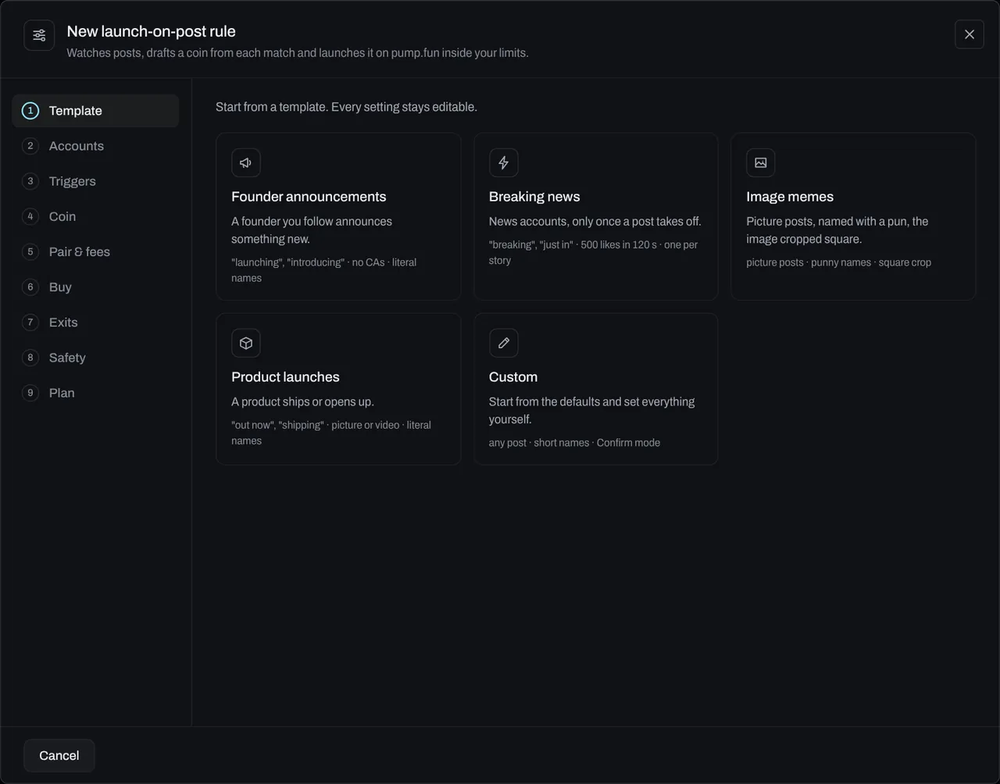
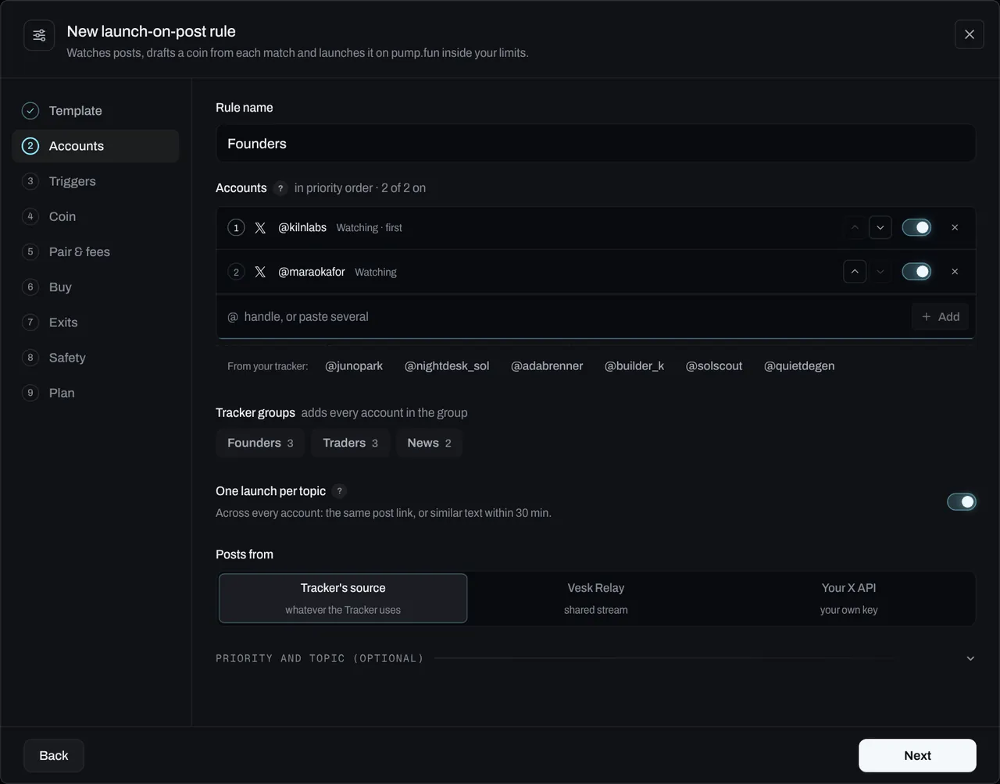
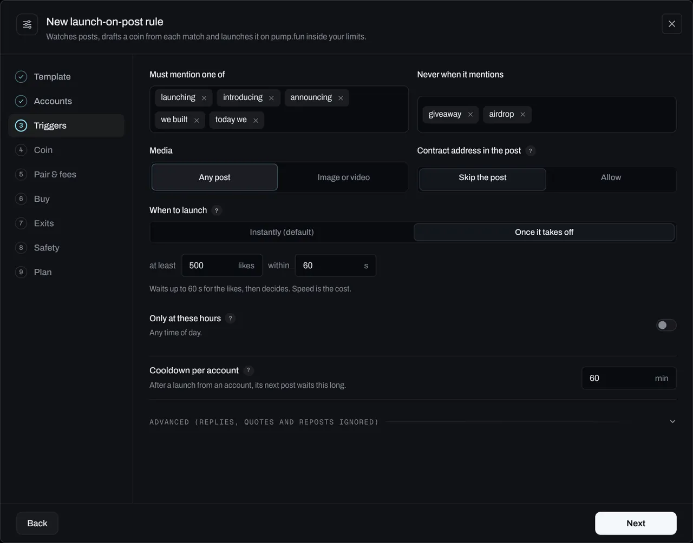
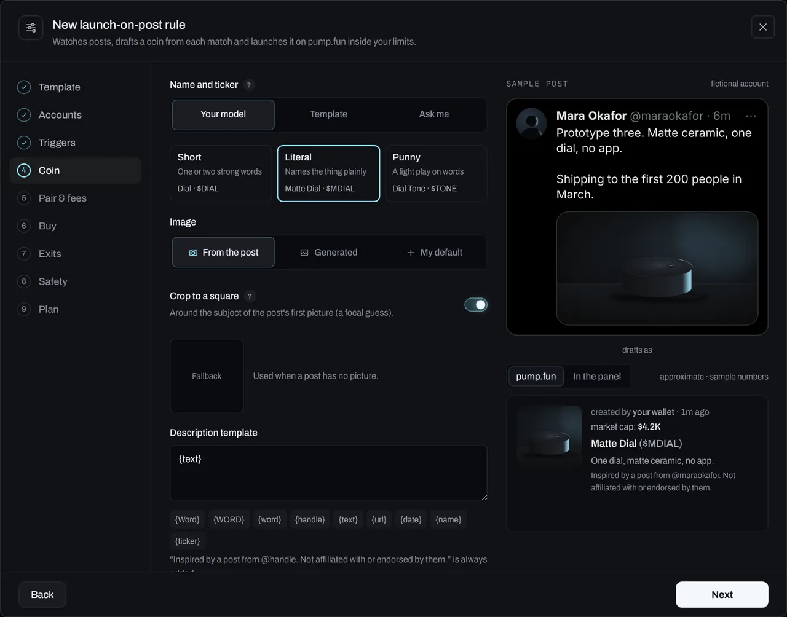
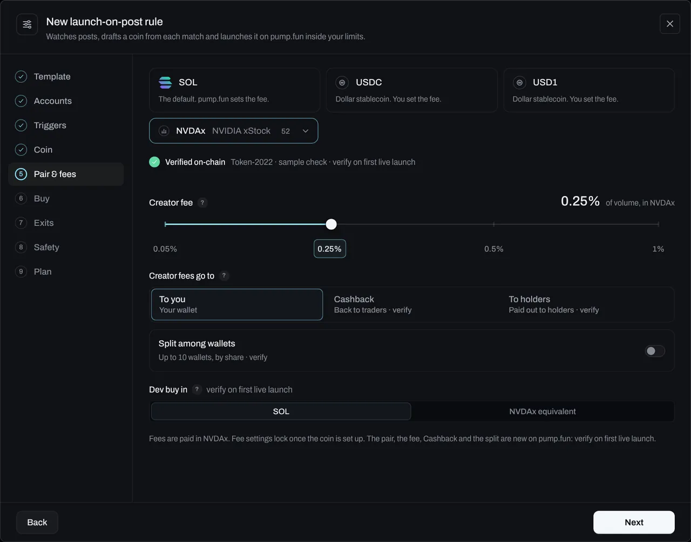
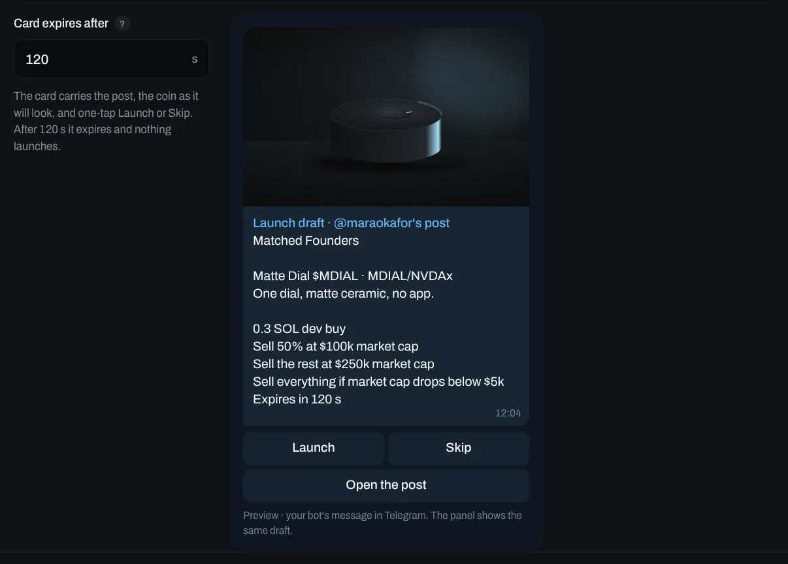
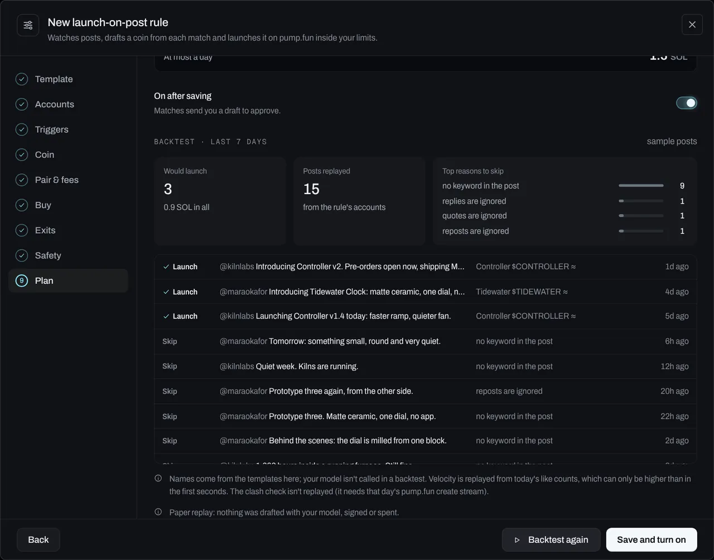
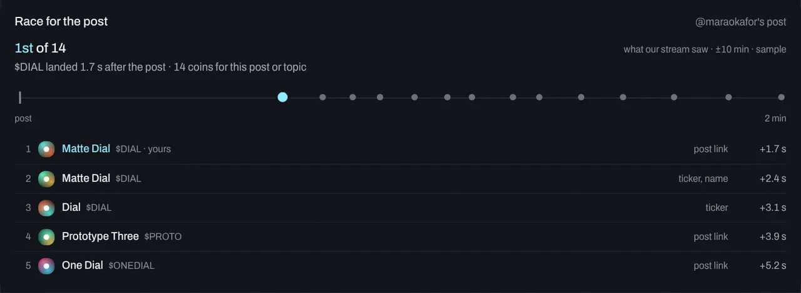

# Launch on posts

A launch-on-post rule watches X accounts you pick. When one of them posts something that matches, Vesk drafts a coin from the post and launches it on pump.fun, either by itself (**Auto**) or after you tap Launch on a card (**Confirm**). Just before it launches it checks whether someone already launched the same post, image, ticker or name. Afterwards it tells you where you landed: *1st of 14 · 1.7 s after the post*. Exits, limits, the never-list and the kill switch apply to every coin.

> Start with Confirm mode and `vesk summon --paper`. Paper mode drafts and logs every launch it would make without signing anything. The **Backtest** replays the last 7 days of posts through a rule and spends nothing.

<!-- flow: post "A post you set a rule for appears; the agent reads it and launches the coin it describes. Sample post." -->

## In the panel

**Rules → Launch on posts.** The page lists the drafts waiting for you, then your rules, each with its stats: launches, how often it was first, the median time from post to landed, PnL, the creator fees it earned and when it last fired. Live shows launch-on-post candidates in their own lane, with the reason for each step (matched, waiting for likes, clash skipped, draft sent, launched).

**New rule** opens the builder: a step dialog with the steps down the left (on a phone, *Step 3 of 9* at the top): **Template, Accounts, Triggers, Coin, Pair & fees, Buy, Exits, Safety, Plan**. Each step is a few fields with a **?** on each; the rarer ones sit under **Advanced**.

### 1. Template

Five tiles. Each fills sensible settings; everything stays editable, and none of them change the honesty rules.

| Template | What it sets |
|---|---|
| Founder announcements | "launching", "introducing", "announcing", "we built", "today we"; skips giveaways, airdrops and posts with a contract address; literal names |
| Breaking news | "breaking", "just in", "confirmed"; only once the post gets 500 likes within 120 s; one coin per story; short names |
| Image memes | Picture posts; punny names; the image cropped square |
| Product launches | "out now", "shipping", "open beta"…; a picture or a video; literal names |
| Custom | The defaults: any post, instant, short names, Confirm mode |



### 2. Accounts

| Setting | Notes |
|---|---|
| Accounts | Pick from your Tracker, add a handle, or paste a list (`@a, @b c`). Each has its own on/off switch: an account that's off stays in the rule and isn't watched (`vesk rules account <id> @handle off`). |
| Priority | The list is the priority order (the arrows move an account). Under *Advanced*, a **priority hold** (0 = instant, the default): a post from an account lower in the list waits that many seconds, and if one higher up posts about the same thing meanwhile, its post is the one launched. |
| Tracker groups | Adds every account in a [Tracker](03-tracker.md) group. |
| One launch per topic | Across every account in the rule: a post with the same link, or text similar to a post it already launched on within the window, is skipped. |
| Posts from | The Tracker's source, Vesk Relay, or your own X API key. |



### 3. Triggers

| Trigger | Notes |
|---|---|
| Must mention one of | Words or phrases, any one of them. Empty means any post. |
| Never when it mentions | Words or phrases that rule a post out (e.g. *giveaway*). |
| Media | Any post, or only posts with an image or a video (exactly a picture or exactly a video under *Advanced*). |
| Contract address in the post | **Skip the post** (someone already launched, or it's a shill) or **Allow**. |
| When to launch | **Instantly** (the default: no wait), or **Once it takes off**: at least N likes within M seconds; Vesk waits up to M seconds for the likes, then decides. Speed is the cost. Needs an X source that returns like counts. |
| Hours | Only inside these time-of-day windows, in the time zone you pick. A window can cross midnight. |
| Cooldown per account | After a launch from an account, its next post waits this long. |
| *Advanced* | Replies, quotes and reposts (each ignored by default). **Patterns**: regular expressions to include (a post matches a keyword *or* a pattern) and to exclude; at most 120 characters each, nested repeats like `(a+)+` are refused. **Languages**, applied when your X source gives a post's language (otherwise skipped, and the log says so). |



### 4. Coin

- **Name and ticker.** *Your model* names the coin from the post in a style: **Short** (one or two strong words), **Literal** (names the thing plainly) or **Punny** (a light play on words). *Template* fills `{Word}`, `{WORD}`, `{word}` (the most nameable word in the post; announcement words like "introducing" are skipped), `{handle}`, `{text}`, `{url}` and `{date}`. **Ask me** (Confirm mode only): the card waits for your name and ticker, with three suggestions to tap (your model's, the post's cashtag, the templates'). Any name that claims to be the person's coin is refused.
- **Image.** *From the post*: the first picture, fetched as PNG from X's CDN and cropped to a square around a focal guess (the stretch of the picture with the most detail, pulled gently to the centre); its short side must be at least the smallest size under *Advanced* (256 px by default), or your default image is used instead. *Generated* (your OpenAI key; without one, your default). Or **My default**, for every coin.
- **Description.** Your template, with the same variables plus `{name}` and `{ticker}`. It always ends with: *"Inspired by a post from @handle. Not affiliated with or endorsed by them."*
- **Links.** Your preset links. Website holds the post link as the source unless you set your own. Telegram and X are your coin's own; the X field is never the person's account or post.

On the right, a **live preview** of the coin drafted from a sample post (a fictional account): as its pump.fun card, and as it will show in the panel (Your launches, Live). The pump.fun card is an approximation in Vesk's own type, with sample numbers.

*Images from posts may be owned by someone else. You're responsible for what you launch.*



### 5. Pair and fees

The launchpad is pump.fun. Any supported quote asset from the [custom pairs list](06-launch-and-presets.md#custom-pairs): **SOL**, **USDC** and **USD1** as tiles, everything else on pump.fun's supported list under **More pairs**, filtered by category (Stablecoins, Crypto, Stocks, Pre-IPO, Metals, Memes, Discovered) with a status per row: **Verified on-chain**, **Listed** or **Discovered**. Picking a custom pair reads its mint on chain right away and shows the result under the tiles. The check runs again before every create.

- **Creator fee** on a custom pair: **0.05% to 1%** of volume, paid in the pair's asset (presets 0.05 / 0.25 / 0.5 / 1). On SOL, pump.fun sets it, so there's no control.
- **Creator fees go to:** **To you**, **Cashback** (back to traders; custom pairs) or **To holders**. On a custom pair, **Split** shares them among up to **10** wallets from your address book, by percentage. Fee settings lock once the coin is set up.
- **Dev buy in** SOL or the pair asset's equivalent (custom pairs).
- The custom pair, the fee range, Cashback, holders and the split are new on pump.fun: *verify on first live launch*.



### 6. Buy

- **Launch mode:** **Standard** (create plus your dev buy in one transaction, no tip by default) or **Manual** (deploy only, no buy).
- **Dev buy** in SOL (or the pair asset, see above).
- **Team wallets:** optional, always disclosed in the description and the treasury report.
- **Advanced:** a [launch preset](06-launch-and-presets.md#launch-presets), Jito tip, priority fee, slippage.

One wallet per coin for buys: your trading wallet, plus team wallets only when disclosed.

### 7. Exits

The same exit engine as every coin: a take-profit ladder by market cap, a timed sell (a share N seconds after launch), a **no-volume exit** (sell everything if less than X SOL trades in N seconds), a stop-loss, a stop below a market cap, a trailing stop and a time limit. See [Exits](07-exits.md).

### 8. Safety

- **Ticker clash check:** just before launching, Vesk reads the pump.fun creates of the last seconds (PumpPortal's new-token stream). If a coin with the same post link, the same image, the same ticker or the same name already launched: **Skip**, **Rename** the ticker (`FERRY` → `FERRY2`), or **Launch anyway**. A post or image clash can't be renamed away, so Rename skips those. Image matching compares the post's picture with the new coins' pictures (the same file by SHA-256, or a near-identical PNG by a 64-bit difference hash). It runs while the name is drafted and never holds a launch more than 0.3 s; it runs in a self-hosted agent.
- **Limits:** launches per hour and per day, SOL per launch, SOL per day; open launched coins under *More limits*.

| Limit | Default |
|---|---|
| Launches per hour / per day | 2 / 5 |
| SOL per launch / per day | 1 / 3 |
| Cooldown per account (Triggers) | 60 min |

The never-list, your global limits, the guardrails and the kill switch apply on top.

- **Mode.** **Confirm** sends a card to Telegram and the panel: the post, the coin as it will look, the plan, and one-tap **Launch** / **Skip** (or the name suggestions, with *Ask me*). It expires after the time you set (30 to 3600 s) and nothing launches. Limits and the clash check run again right before signing. **Auto** launches as soon as a post matches and every check passes.



### 9. Plan

Everything the rule will do, in one list, with the most it can spend in a day. **Backtest 7 days** is a paper replay: the last 7 days of posts from the rule's accounts go through the real matcher, priority order, topic dedupe, limits and coin draft. It lists what it would have launched first, and why it skipped the rest. Nothing is drafted with your model, signed or spent.

- Posts come from your X API's history. When your X source doesn't return history (the relay, or no key), the backtest says so and replays the posts the tracker stored from these accounts.
- Velocity is replayed from today's like counts (an upper bound), and the clash check can't be replayed (it needs that day's create stream).
- The offline preview uses sample posts.



## Race reports

A minute after each launch (then again once the window has passed), Vesk lists every other coin created for the same post or topic: the same post link, ticker, name or image within the window around the post. Where yours landed, and how long after the post, is stored with the launch and shown on **Live**, in **Your launches** and on the coin's page: *1st of 14 · 1.7 s after the post*.

It counts what Vesk's create stream saw. A coin created while the stream was disconnected is missing, and the report says *partial*. A coin that copies the post without linking it, its picture, its name or its ticker isn't counted.



## From the terminal

The same rule from the CLI, the config file, chat, Telegram or MCP.

```panel tab="Panel"
Rules › Launch on posts › New rule
```

```bash tab="CLI"
vesk rules add --launch-on-post @famous,@second --template breaking --pair NVDAx --creator-fee 0.25 --clash rename
```

Every option:

```bash
vesk rules add --launch-on-post @a,@b --dev-buy 0.3 --sell 50%@100k,100%@250k --stop 5k
  [--template founder|breaking|memes|product|custom]
  [--keyword launching,introducing] [--exclude giveaway] [--pattern "\bv\d+\b"] [--exclude-pattern "airdrop"]
  [--media any|image|video|image-or-video] [--ca skip|allow] [--lang en] [--velocity 500/60s] [--hours 09:00-23:00 --tz 1]
  [--priority-hold 20] [--naming model|template|ask --style short|literal|punny] [--image post|generate|mine] [--no-crop]
  [--min-image 256] [--website post|preset] [--groups Founders,News] [--watch-off @b] [--dev-buy-in sol|quote]
  [--pair USDC --creator-fee 0.5 --fees creator|holders|cashback --split <addr>:50,<addr>:50]
  [--clash skip|rename|launch --clash-window 120 --no-clash-image] [--race-window 10]
  [--sell-after 5:100] [--no-volume 0.5/120s] [--max-open 3] [--auto]
vesk rules templates                      # the five templates
vesk rules backtest <id>                  # 7 days of posts through the rule; nothing spent
vesk rules stats [<id>]                   # launches, first-place rate, median post → landed, PnL, fees, last fired
vesk races [$TICKER]                      # race reports
vesk pairs [--search nvda] [--seen]       # the quote pairs, with their statuses
vesk pairs --check NVDAx                  # read a pair's mint on chain now
vesk rules account <id> @handle off       # pause one account without removing it
vesk pending                              # drafts waiting for you (Confirm mode)
vesk pending launch <id> ["Name" $TICKER] | skip <id>
vesk summon --paper                       # drafts and logs every launch it would make, signs nothing
```

In the config file (`vesk.config.yaml`), under `launchRules:` (accounts in priority order; a rule saved by the panel or CLI with the same id wins):

```yaml
launchRules:
  - id: founders
    name: Founders, launch on post
    handles: [kilnlabs, maraokafor]
    trigger: { keywords: [launching, shipping], contract: forbid, patterns: { include: ['\bv\d+\b'] } }
    coin: { naming: model, style: literal, image: post }
    pair: { quote: USDC, creatorFeePct: 0.25, fees: creator }
    clash: { action: skip, windowSec: 120 }
    mode: confirm
```

In chat or Telegram: *"launch a coin when @famous posts with a picture, pair it with USDC, 0.5% fee"*, or *"…ask me for the name"*, *"…punny names"*. You get a rule draft to confirm; it stays in Confirm mode unless you ask for auto. "backtest my rule", "how did my launch rules do", "race for $DIAL" and "which stock pairs can I use" work too. In Telegram a Confirm card has **Launch** / **Skip** (or a key per suggested name); `/launch <id> Night Ferry $FERRY` names it, and a short "Night Ferry $FERRY" reply names the one draft waiting for a name.

MCP tools: `vesk_launch_rule_draft`, `vesk_launch_rule_save`, `vesk_launch_rule_templates`, `vesk_launch_rule_from_template` (with patterns, priority hold, naming and style), `vesk_launch_rule_backtest`, `vesk_launch_rule_stats`, `vesk_race_reports`, `vesk_pairs`, `vesk_pending_launches`, `vesk_pending_decide` (with an optional name). See [MCP](12-mcp.md).

## Settings

Defaults for a new rule (each one is in the builder and has a CLI flag):

| Setting | Default |
|---|---|
| Mode | Confirm, the card expires after 120 s |
| When to launch | Instantly (no wait for likes) |
| Priority hold | 0 s (instant) |
| Replies, quotes, reposts | Ignored |
| One launch per topic | On, 30 min, similarity 0.6 |
| Name and ticker | Your model, Short |
| Image | From the post, cropped square around the subject, at least 256 px |
| Pair | SOL |
| Clash check | Skip, looking back 120 s, image matching on |
| Race report window | ±10 min |
| Limits | 2 / hour, 5 / day, 1 SOL per launch, 3 SOL per day, 60 min cooldown per account |

A rule saved by an older version gets these settings filled in when it loads; nothing it already had changes (older styles read as: punchy → Short, meme → Punny).

## Honesty rules (in code, not settings)

- **Disclaimer:** the description always ends with the line above. It can't be removed or edited away.
- **No claims:** names, tickers and descriptions can't claim to be the person's official, verified, authentic or endorsed coin, or present it as theirs ("@x's coin", "by @x"). That includes a name you type on a card.
- **Links:** the X link field is never the person's account or post. The post only goes in the website (source) field.
- **One coin per post**, ever, across every rule; with topic dedupe on, one per topic.
- **One wallet per coin for buys**; team wallets only when disclosed. **Dev sells are public** in the treasury report.
- **The rest of the [guardrails](14-guardrails.md) still apply:** no hidden supply or stealth dev buys, no volume bots or wash trading, no fake engagement, no impersonation, no coordinated pumps.

## Being first

The image fetch starts the instant the post arrives, connections stay warm, and the launch goes out in one transaction. Every step from post received to landed is timed in ms and logged, and the race report shows where that put you. See [Tracker → Being first](03-tracker.md#being-first).

## Limits and what's approximate

- **Start with Confirm and paper mode.** Auto launches as soon as a post matches and every check passes.
- **Velocity, language, likes and views** need an X source that returns them. The hosted panel checks velocity once, when the post arrives (it doesn't wait); the self-hosted agent waits and re-checks.
- **The priority hold and image matching** run in a self-hosted agent. The hosted panel handles each post as it arrives (the topic check keeps the first) and matches by post link, ticker and name.
- **The clash check and race reports** read PumpPortal's new-token stream (self-hosted) or the relay's copy of it (hosted): they count what that stream saw.
- **Custom pairs, the 0.05-1% fee, Cashback, fees to holders, the fee split and a dev buy in the pair asset**: *verify on first live launch* (see LAUNCH-READINESS). Every custom-pair mint is read on chain first; a failed check refuses the create.
- **Model names can be refused.** If a suggestion breaks the honesty rules, Vesk uses your template instead.
- **Speed is measured, not promised.**
- **The previews and the backtest in the offline preview** use sample posts and sample numbers, labelled.
