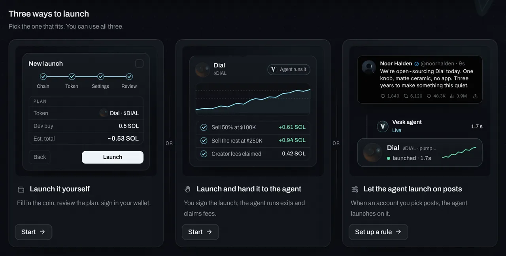
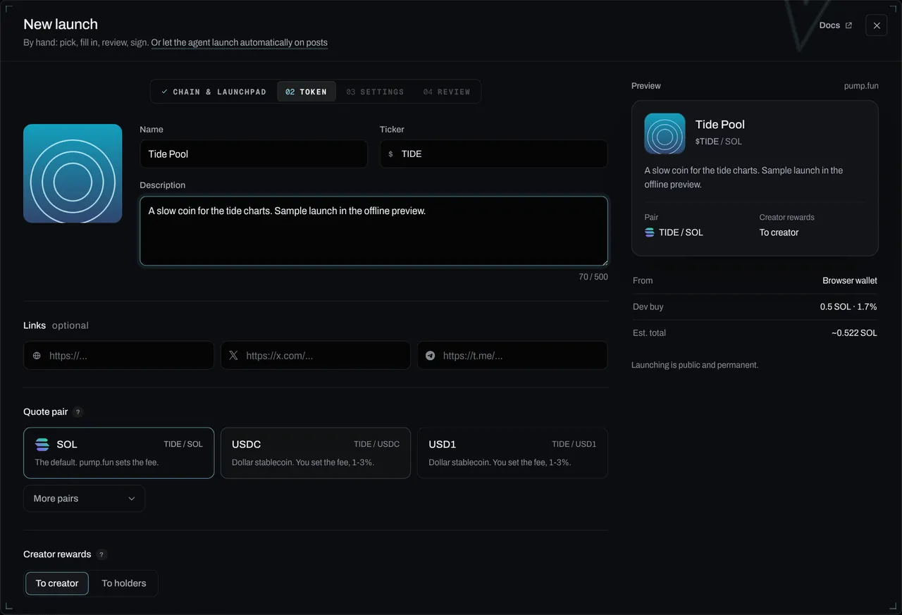
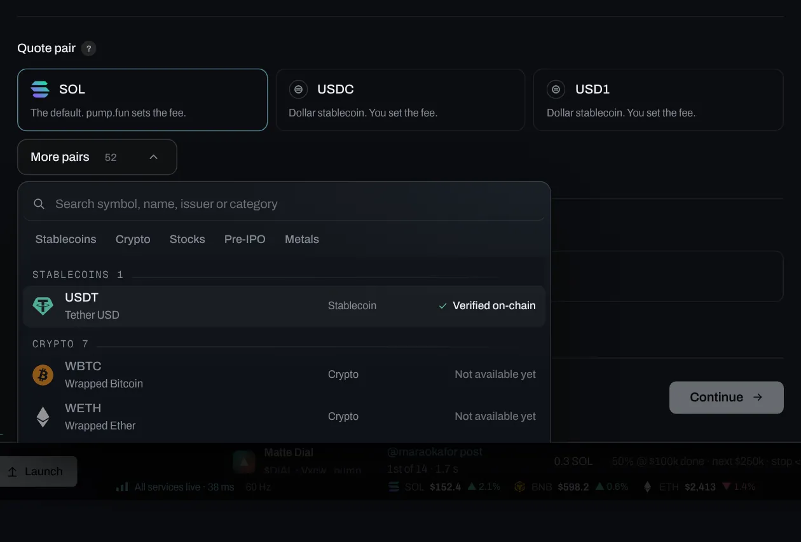
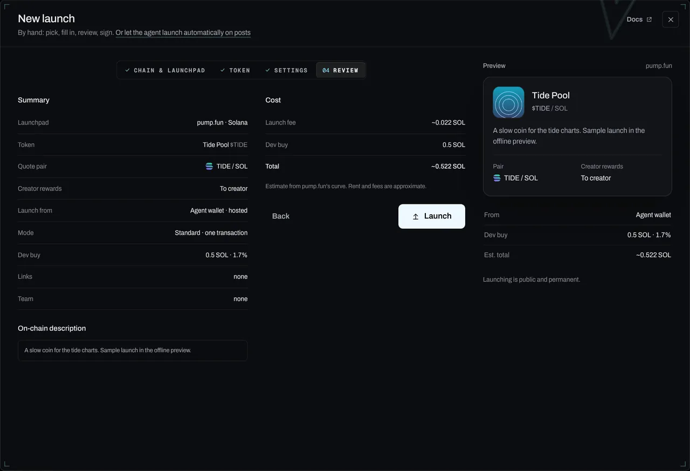
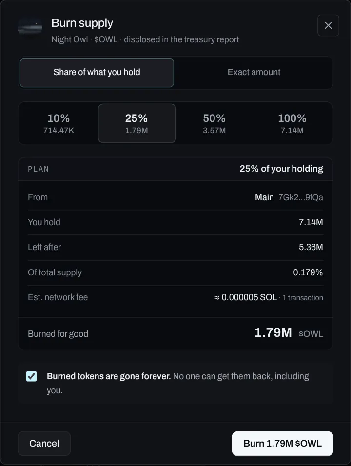
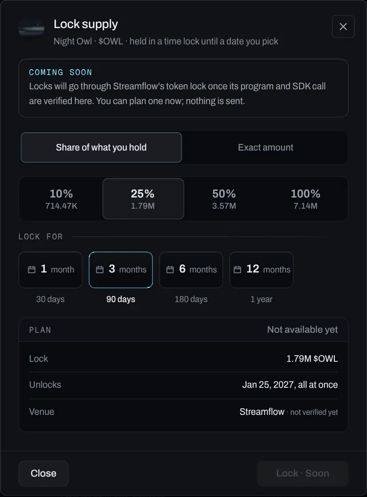

# Launch flow and presets

You can launch from the panel (**Launch**), the CLI, chat, Telegram (draft only) or any MCP client. They all use the same plan, validation and guardrail (`packages/core/src/launch/plan.ts`), so a launch behaves the same everywhere.

## In the panel

**Launch** (or **New launch** on that page) starts with three paths:

- **Launch it yourself.** Chain & launchpad → Token → Settings → Review, signed by **your own browser wallet** (Phantom, Solflare, Backpack or any Wallet Standard wallet). The server builds the transaction with your wallet as the creator and signs it only with the fresh mint key; your wallet shows it and you approve it. The signed transaction is checked against what was built before it's sent (Jito for Standard, your RPC for Manual).
- **Launch and hand to the agent.** The same flow signed by an agent wallet (hosted, or your paired self-hosted agent, which gets the launch queued and signs it on its next poll). Then **Hand it to the agent**: exits (market-cap ladder, timed sell, stop, trailing stop, time limit), *Run your coin* switches and your limits, then **Agent runs it**.
- **Let the agent launch on posts.** Opens the launch-on-post rule builder. See [Launch on posts](05-launch-on-post.md).

A browser-wallet launch is solo (team wallets need wallets Vesk can sign for), and the agent can only run exits from wallets it signs for: send the dev tokens to the agent wallet if you want it to manage them. Creator fees stay with the creator wallet.

### Step by step

1. **Open Launch.** Sidebar → **Launch** (the button pinned at the bottom of the sidebar opens the flow straight away). The card at the top has **New launch**, and **Clone a token** or **Import a token** under it.

   

2. **Fill in the token.** Name, ticker, picture, description and links. The steps along the top (Chain, Token, Settings, Review) show where you are; nothing is sent while you fill them in.

   

   

3. **Review, then launch.** The review lists everything that goes on-chain, the dev buy and the total with fees. **Launch** is the only button that sends anything. From your browser wallet, the wallet then asks you to approve it; an agent wallet signs it for you.

   

> Prefer to describe it? In the panel press **Ask Vesk to do it all**, or say it in chat: *"launch a coin called Night Owl ($OWL) with a 0.5 SOL dev buy"*. Vesk fills in the whole flow. If you set up a model, it also suggests a name, ticker and description. Nothing is signed until you review the plan and press Launch.

### 1. Chain and launchpad

Solana only for now. Ethereum, BNB Chain and Base are listed as *Soon* (Solana, Ethereum and BNB Chain with their official marks from Simple Icons; Base by name until its official file is supplied).

A launchpad is selectable only when Vesk has a working, tested code path for it. The ready one is a tile with its facts (pairs, the dev buy in the create transaction, team wallets as one Jito bundle); the rest are one quiet *Soon* list, each with what it waits for on hover:

| Launchpad | Status | How |
|---|---|---|
| pump.fun | **Ready** | PumpPortal local transactions (unsigned, you sign); create + dev buy in one transaction, team wallets as one Jito bundle |
| LetsBonk | Soon | Trading works; the create path isn't built yet |
| Meteora DBC | Soon | Needs Meteora's Dynamic Bonding Curve SDK |
| StonkFun | Soon | An adapter scaffold exists; it waits for a confirmed program ID and create interface. See [Launchpads](38-launchpads.md#stonkfun) |
| Bags, Anoncoin, Surge, Printr, Stoxes, Lesgo, meme.fun | Soon | Not integrated yet |

**Clone a token** prefills the name, ticker, image and socials from a mint you paste. Use it for your *own* earlier coin or as a starting point. Don't impersonate an existing project: change the name and ticker, and keep links your own. Impersonation is refused by the guardrails.

**Import a token** adds a coin you already launched (from the same creator wallet) so Vesk can run it: updates, fee claims and treasury reports.

### 2. Token details

| Field | Rules |
|---|---|
| Name | 2–32 characters |
| Ticker | 2–10 letters or digits |
| Description | Up to 500 characters, minus room for the team-wallet disclosure if you use one |
| Image | PNG, JPG, GIF or WebP, under 4.5 MB |
| Website / X / Telegram | Optional, `https://` links |
| Quote pair | Tiles: **SOL** (default), **USDC**, **USD1**. **More pairs** opens a searchable list of every [custom pair](#custom-pairs) on pump.fun's supported list, with a filter by category (All, Stablecoins, Crypto, Stocks, Pre-IPO, Metals, Memes), each row with its picture, symbol, name and issuer. Picking one reads its mint on chain and shows *Verified on-chain*, or *Refused* with the reason. |
| Creator fee | **SOL pair:** fixed by pump.fun, so there's no control and no number, and nothing is sent. **Custom pair:** 0.05% to 1% of volume, **paid in the pair's asset**: drag the slider or press a preset (0.05 / 0.25 / 0.5 / 1%). It shows in the preview card and the review, and goes on the create request in basis points (`creatorFeeBps`, e.g. 25 for 0.25%). Fee settings lock once the coin is set up. From the CLI: `--quote USDC --creator-fee 0.25`. |
| Creator fees go to | pump.fun's own setting, shown only for launchpads that offer it. **To you** (default), **Cashback** (fees go back to traders; custom pairs) or **To holders** (100% to holders; anyone holding more than $20 of your coin qualifies). Under *To you* on a custom pair, **Split among wallets**: up to 10 wallets whose shares add up to 100%. All but *To you* go through create-request fields from the capability config and are marked *verify* until a live launch confirms them. Settings lock once the coin is set up. |

On **Create**, Vesk saves the metadata ("Saving metadata…" → "Metadata saved"). In hosted mode it uploads the image and metadata to pump.fun's IPFS endpoint. In self-hosted mode it saves a draft, and the upload happens on your machine.

### 3. Launch settings

#### Standard (recommended)

Your dev buy is **part of pump.fun's create transaction**, so it lands with the create and can't be front-run. It's one transaction, sent through your RPC: no Jito tip or priority fee is needed.

| Field | Default | Notes |
|---|---|---|
| Dev buy | 0.5 SOL | The panel shows the estimated % of supply (pump.fun curve, approximate) |
| Jito tip | none | Under **Advanced (optional)**. Set one to send even a solo launch as a Jito bundle. With team wallets the launch is a bundle and needs a tip: 0.0001 SOL unless you set one. |
| Priority fee | none | Under **Advanced (optional)**. On the create (and on each team-wallet buy) for faster inclusion. |
| Slippage | 10% | Under **Advanced (optional)** |

The cost estimate is the launch fee (rent and network fees, about 0.022 SOL) plus your dev buy; a tip or priority fee shows only when you set one.

#### Manual

Deploy only, no buying. Buy or sell yourself later. Cheapest.

#### Team wallets (disclosed)

Optional, Standard mode only. Pick up to 4 of your own active wallets (a Jito bundle holds 5 transactions). Each one buys the same amount in the launch bundle. The panel shows *"Team holds X% across N disclosed wallets"*, and each picked wallet with its own name and the role: **Wallet 2 · Team**. "Team" is the role a wallet has in this launch, not its name; see [Wallet names](30-wallet-labels.md#team-is-a-role-not-a-name). Team wallets are your own imported wallets ([Wallets](08-wallets.md)).

These wallets are **always disclosed**. Their full addresses are added to the coin description, which pump.fun shows on the coin page:

```
Team wallets (disclosed): 3 wallets bought ~6.1% of supply at launch, 0.2 SOL each: <address 1>, <address 2>, <address 3>
```

The same addresses go into every treasury report. Your private names for these wallets are never published. You can't turn the option on without the disclosure, and the core refuses a plan where `disclosed` is false.

#### What Vesk doesn't build

No stealth or "block 0" presets, front/back-run MEV layers, temporary holder wallets, CEX-routed or hidden funding, bubble-map or "detection" meters, volume bots, market-maker bots, or randomized "organic-looking" multi-wallet buys. They exist to deceive buyers, and the guardrails refuse requests for them.

### Review and launch

The review screen shows every field, the on-chain description (with the disclosure, if any), the % of supply and a cost estimate: the launch fee (account rent of about 0.02 SOL, token-account rent per buying wallet, network fees) + buys, plus a tip or priority fee only if you set one (or the automatic bundle tip with team wallets). Settings not yet verified on a live launch are listed in one line above the Launch button ("Verify on first live launch: …"). On a USDC or USD1 pair the review shows the creator fee and the asset it's paid in; on SOL there's no fee row. Then press Launch and follow the progress:

1. Upload metadata
2. Build transactions (PumpPortal returns them unsigned)
3. Sign locally and send the bundle to Jito
4. Landed in slot N
5. Coin page link

Guardrails run first: kill switch (Manual still works with it on), per-trade max for the dev buy and each team buy, daily cap for the total, balances, and only your own wallets.

When it lands, the review turns into the coin: its picture, name, ticker and address, the slot it landed in, its pair (and creator fee on a non-SOL pair), the dev buy and team share, and one next step, **Hand it to the agent** (exits, fee claims and disclosed buybacks, inside your limits). **Open coin page** and **Launch another** sit under it, and a notification with the coin goes to the [notification centre](32-notifications.md). If it fails, the step that failed is marked, the reason is shown, and **Back to settings** or **Try again** keep everything you entered; nothing is retried on its own.

**Your launches** lists the coins you launched here, from the CLI or from a post. On a new account it says how to start: New launch, or Import a coin you launched before.

### Run your coin

In the panel, **Hand it to the agent** (Launch) or **Your coin** on the coin page's Positions tab sets this per coin: the hosted agent claims fees hourly and runs disclosed buybacks; a self-hosted agent picks the settings up on its next sync and also posts updates to your linked accounts. In the CLI, add a `coin` block to your config and Vesk keeps your community informed and your treasury transparent:

- **Updates** to your own X account and Telegram channel, on a schedule and at market-cap milestones.
- **Community answers** in your Telegram group, from the FAQ you write, labelled as automated.
- **Creator fees** claimed on a schedule, reported with transaction links. Reports also list your disclosed team wallets.
- **Buybacks and burns** (optional, off by default): a share of claimed fees, at most once an hour, always disclosed.

Everything goes through the guardrails. No volume, no sockpuppets, no coordinated anything.

### Burn and lock supply

For a coin you launched, the coin page (**Positions → Your coin**) and **Your launches** (the row's **Burn** and **Lock**) have two supply actions.

**Burn supply** removes tokens from the supply for good: one SPL Token `BurnChecked` from your dev wallet (the classic Token program or Token-2022, read from the mint), signed by the hosted wallet or your agent.

1. Pick a share of what you hold (10%, 25%, 50%, 100%) or an exact amount.
2. Check the Plan: the wallet it burns from, what you hold, what's left after, its share of the total supply and the network fee.
3. Tick **Burned tokens are gone forever**. **Burn** stays off until you do.
4. *Preparing* re-reads what you hold (so a sell in between can't over-burn), *Burning* sends the one transaction, *Done* shows the amount, the transaction and "Listed" in the treasury report.

   

Every burn is in the treasury report with its transaction, and when the agent runs the coin (**Run your coin**) its next public update says so. The same burn three ways:

```panel tab="Panel"
Positions › Your coin › Burn
Launch › Your launches › Burn
```

```bash tab="CLI"
vesk burn '$DIAL' 25%            # plans, shows what's left after, asks before sending
vesk burn '$DIAL' 1.5m           # an exact amount of tokens
```

```text tab="Chat"
burn 10% of $DIAL
```

Over MCP: `vesk_burn_plan`, then `vesk_burn_supply` with `confirm: true`.

**Lock supply** (Soon) will hold tokens in a time lock until a date you pick, through Streamflow's token lock. Its program ID and SDK call haven't been verified for this build, so nothing is sent: the dialog shows the plan (how much, for how long, when it unlocks) and says it's coming. `vesk lock '$DIAL' 20% --days 90` and the MCP tool `vesk_lock_supply` do the same.

   

## Custom pairs

pump.fun's **Custom Pairs** (launched 2026-09-09) let a coin trade against a quote asset other than SOL. Bonding-curve and PumpSwap protocol fees are the same as a SOL launch, and pump.fun says half of Custom Pairs revenue goes to PUMP buybacks. Vesk's list is `core/src/launch/pairs.ts`: one entry per asset with its symbol, name, category, mint, picture, issuer and status.

The list is pump.fun's own: its [Supported Pair Assets](https://pump.fun/docs/custom-pairs) page, as updated on 9 October 2026 (155 assets with their mints). Every mint in Vesk's list is copied from that page, never from memory, and is still read on chain before each use. The symbols are the ones pump.fun shows; where pump.fun spells one differently from the token (APPLX for AAPLx, ETH for WETH), both spellings find it.

| Category | In the list |
|---|---|
| Stablecoins | USDC, USD1, CHIP (USD.AI) |
| Crypto | 35: majors and wrapped assets (WBTC, WETH, XRP, DOGE, ZEC, XMR, SUI, NEAR…), DeFi and Solana tokens (PUMP, RAY, MET, ORE, AAVE, UNI…), staked SOL (hSOL) and fan tokens (PSG, AFC, CHZ) |
| Stocks | 64: xStocks by Backed (AAPLx, NVDAx, TSLAx, SPYx, QQQx…) and Backpack Securities (BA, BABA, COST, NKE, HOOD, MU…) |
| Pre-IPO | SpaceX (SPCX, Backpack Securities) |
| Metals | GLDx (gold xStock), PAXG |
| Memes | 47 memecoins (BONK, $WIF, PENGU, SPX, Fartcoin, TRUMP…) |
| Discovered | quote mints seen in live pump.fun creates that aren't on the list |

That's 153 pairs you can pick: SOL, USDC and USD1 as tiles, 150 more under *More pairs*. USD1 isn't on pump.fun's page; it stays a tile as an earlier launch option, and the on-chain check still runs before any create on it. Left out on purpose: **ANSEM**, **ALON** and **Cupsey** (named after real people; never listed, and dropped by discovery). Pairs Vesk had before that pump.fun doesn't list (USDT, mSOL, xSOL, the SPCXx xStock, PreStocks and T-tokens, SILV) were dropped; discovery adds any of them back if it shows up in a live create.

| Status (in the picker) | Meaning | Can be picked |
|---|---|---|
| Verified on-chain | Its mint passed the on-chain check through your RPC (cached; re-read before every create) | Yes |
| Listed | A mint from pump.fun's supported list, not yet checked from this account | Yes; the check runs first |
| Discovered | A quote mint seen in live pump.fun creates (`quote_mint`), with how many | Yes, after the same check |
| Refused | The last check failed; the reason is shown | No create goes out until a check passes |

- **The mint check.** Before any create on a non-SOL pair, Vesk reads the mint through your RPC (`getAccountInfo`): the account must exist, be owned by the SPL Token or Token-2022 program, be an initialized mint with readable decimals, and match the decimals on record when known (USDC: 6). Any failure refuses the create with the reason, and nothing is built or signed. A pass is cached for 10 minutes and remembered, so the pair shows *Verified on-chain*. The freeze authority is read and disclosed (*the issuer can freeze it*): regulated issuers usually keep one. The log says what it read, e.g. *NVDAx quote mint checked on chain: Token-2022, 6 decimals*. `vesk pairs --check NVDAx` runs it now.
- **Pair discovery.** The agent and the hosted relay watch pump.fun's creates (PumpPortal's new-token stream); each create's `quote_mint` is counted. A new mint is added under *Discovered* with its name and decimals read from chain (a symbol already in the list gets the mint's first characters after it, so two rows never read the same). Discovered pairs go through the same check before use. A listed mint is never overwritten by a discovered one.
- **Fees** on a custom pair: 0.05% to 1%, paid in the quote asset; Cashback and a split among up to 10 wallets are options. You claim them in that asset on [Claim](39-claim.md).
- **Pictures.** Each pair shows its token's own picture (its metadata image, or the issuer's official token mark), from `public/logos/pair-<symbol>.png|svg`, matched by mint. A picture that fills its square fills the circle; a mark on a transparent background sits on a plate. Pairs whose picture shows a real person (TRUMP, GIGA, 67, gork, neet), and two wide banners that read as nothing in a circle (Fartcoin, MANIFEST), show their ticker on a plate instead. A company's corporate logo is never used for a token it doesn't issue. See `public/logos/README.md`.
- **Verify on first live launch:** the create-request field names (`quoteMint`, `creatorFeeBps`, `cashback`, `creatorFeeRecipients`). See LAUNCH-READINESS.

`vesk pairs` lists them; `vesk pairs --search nvda`, `--category stock`, `--seen` (with discovered pairs and checks), `--check NVDAx`. MCP: `vesk_pairs` (with `check`).

## From the terminal

```bash
vesk launch --name "Night Owl" --ticker OWL --image ./owl.png \
  --desc "A coin for people who trade at 3am." \
  --x https://x.com/nightowl --tg https://t.me/nightowl --web https://nightowl.xyz \
  --mode standard --dev-buy 0.5 --jito 0.001 \
  --team-wallets 2 --team-sol 0.2      # optional: your first 2 active wallets (Wallet 1, Wallet 2); always disclosed

vesk launch --name "Glint" --ticker GLINT --image ./glint.png --mode manual

vesk launch --name "Tide Pool" --ticker TIDE --image ./tide.png --dev-buy 0.2 \
  --quote NVDAx --creator-fee 0.25     # custom pair: fee 0.05-1%, paid in NVDAx (verify on first live launch)
  [--fees creator|holders|cashback] [--split <addr>:60,<addr>:40]   # --split: to you, shared among these wallets
```

On a SOL pair `--creator-fee` is refused: pump.fun sets that fee. The CLI prints the pair, the fee and anything not yet verified before it asks to launch.

### MCP and chat

- `vesk_launch_plan`: dry run. Returns the summary, % of supply, cost and the exact on-chain description.
- `vesk_launch`: needs `VESK_MCP_ALLOW_TRADES=1`, `confirm: true` and a local image path.
- `vesk_wallets`: your wallets (public data).
- Chat (CLI, Telegram, panel): "launch a coin called … ($TICKER) with a 0.5 SOL dev buy" gives you a draft and the matching command, or opens the prefilled Launch page.

## Settings

### Launch presets

A preset is how you launch, saved once (**Setup → Launch presets**, or `vesk presets add`). Deploy, Instant deploy and launch-on-post rules all use presets.

| Field | Notes |
|---|---|
| Launchpad, quote pair | pump.fun, SOL. Other quote pairs only where the launchpad supports them. |
| Creator fees | To creator or to holders, only where the launchpad offers it (see above). |
| Dev buy | SOL. **0 = free launch.** |
| Jito tip, priority fee, slippage | |
| Team wallets | 0-4, always disclosed. |
| Links | Your website, X (your coin's account) and Telegram. An empty website means the post becomes the source link. |
| Image | From post, generate (OpenAI key), or your own image. |
| Naming | Template (fastest) or your model. |
| Exits | Dev-sell timers in seconds, market-cap targets, a market-cap stop. See [Exits](07-exits.md). |

**Free launch:** no dev buy, but you still pay network and launchpad fees, about ~0.02 SOL on pump.fun today. That figure is a constant in the config (`FREE_LAUNCH_COST_SOL`). Check pump.fun's current fees.

```bash
vesk presets add --name "Standard" --dev-buy 0.3 --sell 50%@100k,100%@250k
vesk presets add --name "Dev sells at 5 s" --dev-buy 0.5 --sell-after 5:100
vesk presets add --name "Free" --dev-buy 0
vesk presets default <id>       # used by Instant deploy
```

## Limits and what's approximate

- **pump.fun only, for now.** Other launchpads show *Soon* until Vesk has a working, tested create path for them.
- **Costs are estimates:** the % of supply and the dev buy use pump.fun's public curve constants; tips, priority fees and rent are approximate, and a free launch still costs about 0.02 SOL (`FREE_LAUNCH_COST_SOL`).
- **Verify on first live launch:** custom quote pairs (`quoteMint`) and every listed mint, rewards to holders (`creatorFeeRecipient`), Cashback (`cashback`), the fee split (`creatorFeeRecipients`) and the creator fee on custom pairs (`creatorFeeBps`, 0.05-1%) ran only against mocks. They're marked in the panel, the CLI and the review; if PumpPortal refuses one, nothing is signed or sent. Fees from those coins are collected on [Claim](39-claim.md).
- **A browser-wallet launch is solo**: team wallets need wallets Vesk can sign for, and the agent only runs exits from wallets it signs for.
- **Guardrails first:** kill switch (Manual still works with it on), per-trade max for the dev buy and each team buy, daily cap for the total, balances, only your own wallets, always-disclosed team wallets.
