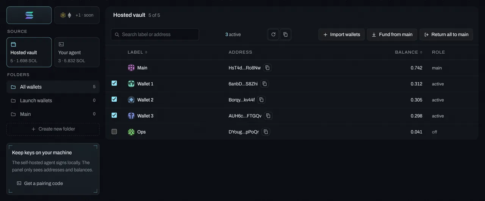

# Wallets

Your main wallet signs by default; import as many of your own wallets as you like to fund them, sell from them, or use them as disclosed team wallets at launch. The address book labels every other address you deal with. Public addresses only: nothing in the panel ever shows or stores a key in the clear.

## In the panel

**Setup → Wallets** has four tabs.

### Wallets

The tab has three parts. On the left, the **source** (the **Hosted vault**, or **Your agent**: the wallets your paired self-hosted agent reports) and your **folders**, each with how many of that source's wallets are in it; **Create new folder** opens the Folders tab. On the right, the table: search by label or address, **Refresh balances** and **Copy these addresses**, the actions, and headers you can sort by (Label, Balance). A folder with none of that source's wallets says so, with **Edit folders** and **Show all wallets**.



Your main wallet and the wallets you imported, with balances and an **active** switch (active wallets can buy and be picked as team wallets). Each wallet has a name: **Main**, then **Wallet 1**, **Wallet 2**, … unless you rename it. Click the pencil next to a name to rename it there; the name shows everywhere. See [Wallet names, labels and icons](30-wallet-labels.md).

- **Import wallets**: paste keys or drop a file (one key per line, CSV `label,key`, or JSON).
- **Fund from main**: split SOL evenly or set amounts per wallet.
- **Return all to main**: everything back to the main wallet.
- **Pair** a self-hosted agent, and the hosted trading wallet (withdraw, export the key).

**Main** is created or imported by `vesk init`, encrypted in `~/.vesk/keystore.json` (scrypt + AES-256-GCM, mode 0600). In hosted mode, the panel creates a separate trading wallet, envelope-encrypted server-side.

- Self-hosted: keys are encrypted into your keystore, on your machine. The panel never sees them; it shows the public list your agent reports.
- Hosted: **Wallets → Import wallets** sends keys over TLS to your hosted vault, where each one is envelope-encrypted with its own data key right away.
- Keys are never printed, logged or shown again. Import errors point at line numbers and never echo key material.
- Funding and returns are plain System Program transfers from one wallet to another, visible on-chain. Nothing goes through exchanges or intermediate wallets.

### Folders

Group your own wallets (launch wallets, snipers, cold) in **Wallets → Folders** or with `vesk folders add "Launch wallets" <addr>,<addr>`. Folders only organise. Team wallets at launch are disclosed whatever folder they're in.

### Address book

Label the addresses you send to or watch, give them a colour marker and an image, and bookmark the ones you use. Bookmarks are offered first when you withdraw SOL or send tokens. Public addresses only; nothing here is a key. Labels and images show wherever that wallet appears in the panel (see [Wallet names, labels and icons](30-wallet-labels.md#labels-for-any-wallet)). Your own wallets' names are entries too, under **Your wallets**.

CSV columns: `address,label,marker,bookmark,note,track,kol,avatar,own` (`own` marks your own wallets' names). `avatar` is a reference (`upload:<id>` or `gen:<style>:<seed>`), not the picture. An import keeps the references; the image files stay where they are (your hosted bucket, or `~/.vesk/avatars/`). Bad rows are reported with their row number and skipped, and so is a bad image reference.

The agent has no image codec, so `vesk book avatar` doesn't resize or re-encode. It checks the type from the bytes, refuses SVG and anything over 512 KB, and strips the metadata chunks and segments from PNG and JPG before saving. Upload WebP and GIF in the panel, which re-encodes everything.

### Recover rent

Every token you've held leaves an empty token account behind with about 0.002 SOL of rent in it. **Claim → Cleanup** (it was Wallets → Recover rent, and that link still opens it; or `vesk rent`; see [Claim](39-claim.md#cleanup)) lists the wallets with empty ones (balance 0), how many and the SOL you get back, and closes them in batches after you confirm (**Close and reclaim**). Accounts for coins you still hold are never touched.

### Send tokens

From a coin page's Positions tab (or the agent), send tokens to any address: Vesk creates the recipient's token account if needed (TransferChecked). One rule applies: **dev supply of a coin you launched can't be moved into your other wallets**, because that would hide it from holders. Sell or burn it instead; both are listed in your treasury report.

## From the terminal

```bash
vesk wallets import ./wallets.txt      # one key per line, CSV "label,key", or JSON
vesk wallets                           # Main, Wallet 1, … (or your names), balances, active
vesk wallets label <n|main|addr> "Sniper desk"   # rename (empty = default name)
vesk wallets activate <addr> | deactivate <addr> | rm <addr>
vesk wallets fund --total 1            # split 1 SOL evenly across active wallets
vesk wallets fund --each 0.25 --to <a>,<b>
vesk wallets return                    # everything back to the main wallet
```

```bash
vesk book add <address> "Exchange deposit" --bookmark --marker ice
vesk book                                   # bookmarks first
vesk book export --format csv --out book.csv
vesk book import ./book.json                # JSON ({ entries: [...] } or an array) or CSV with a header
vesk book track <address>                   # follow its trades (Tracker, alerts, Pulse tracked dev)
vesk book avatar <address> ./face.png       # PNG or JPG ≤ 512 KB, metadata stripped, kept in ~/.vesk/avatars/
vesk book avatar <address> --gen rings --seed 3   # or a generated avatar: monogram, rings, grid, stripes
vesk book avatar <address> --clear          # back to the identicon
vesk folders [list | add "<name>" <addr,addr> | rm <id>]
vesk rent [--yes]                           # close empty token accounts
```

## Settings

| Setting | Where | Notes |
|---|---|---|
| Trading wallet | Trading settings | The one wallet buys come from. Defaults to Main. |
| Active | Wallets tab | Active wallets can be funded together and picked as team wallets. |
| Name | Wallets tab, anywhere a wallet shows | Default Main / Wallet n; private. |
| Folders | Folders tab | Only organise; no effect on trading. |
| Bookmarks | Address book | Offered first in Withdraw and Send tokens. |

### Team wallets at launch

Up to 4 of your active wallets can buy in the launch bundle as **team wallets** (Standard mode), with the same amount each. They are **always disclosed**: full addresses go in the coin description and every treasury report. The option can't be turned on without that disclosure. See [Launch flow and presets](06-launch-and-presets.md).

Vesk doesn't do stealth bundles, temporary holder wallets, hidden or exchange-routed funding, or randomized "organic-looking" buys. See [Guardrails](14-guardrails.md). In that launch a team wallet shows as **Wallet 2 · Team**: Team is its role there, not its name.

## Limits and what's approximate

- **Keys never come back.** They're never printed, logged or shown again; import errors point at line numbers and never echo key material.
- **One wallet buys a coin.** Buying the same coin from several of your wallets is refused (coordinated buying); sells can come from many.
- **Dev supply of a coin you launched can't be moved into your other wallets** (it would hide it from holders). Sell or burn it; both are in the treasury report.
- **Cleanup** only closes accounts with a zero balance; about 0.002 SOL each.
- **Self-hosted:** the panel shows the public list your agent reports, and actions you start there are queued for the agent, which signs within about 2 s.
