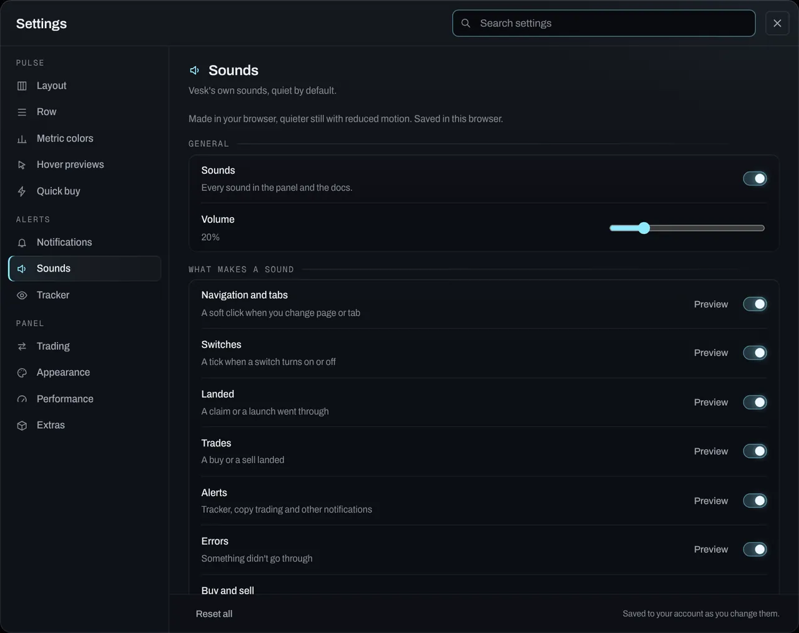

# Notifications

Vesk tells you when something happens in one place: a small stack of cards at the top of the panel, a sound if you want one, a desktop notification when the tab is in the background, and a history in the notification centre (the bell). A trade is one card from the click to the result. Failures always reach you; everything else follows your settings.

## In the panel

### The stack

Cards appear at the top centre by default, under the top bar (Settings → Notifications → Appearance → Position: top centre, top right, bottom right or bottom left). By default they're a **list**: every card in full, one under the other with a small gap, the newest on top, three at a time. When more than three are waiting, **+N more** under the list shows the rest. When a card arrives or leaves, the others glide to their new place. Pointing at a card (or Tab into the list) pauses the timers; nothing moves.

Settings → Notifications → Appearance → Style:

- **List** (default): every card in full.
- **Stacked**: the older deck: the newest in front and two older ones peeking out behind it, a little smaller; point at it and it opens into the list.
- **Compact**: the list with one line per card (the title and the start of the detail; trade steps and facts are left out, the centre has them).
- **Minimal**: no card, just the kind's icon and the text, on a faint blurred backdrop so it stays readable over a busy table.

The stack never covers Instant Trade, an open dialog, the notification centre or the trade panel's Buy button. If its spot is taken it moves to the next free one (top right, top left, a bottom corner).

To dismiss a card: its **×**, a drag or swipe sideways (mouse, touch or pen), or **Esc** for the newest. Moving cards never moves the page underneath.

Every card has the same layout: the coin's picture or the wallet's, with a small glyph for the kind, a title, one line of detail, a time or latency chip, and a thin bar for the time it has left.

### A trade, start to finish

A buy or sell from anywhere in the panel (a coin page, Pulse, Instant Trade, the Tracker, a card's own buttons) is one card that changes as it goes:

1. **Signing, Sent**: lit while the request is out. Your agent or the hosted wallet signs and sends the transaction inside that one request, so the panel shows the two together rather than pretending to see them separately.
2. **Landed in N ms**: N is measured in your browser from the click to the confirmed answer. The card then shows the market cap at the fill, what you spent and got (SOL and tokens), the average price, the network and priority fees, the slot, and the transaction (a Solscan link on a live account; *tx: preview* in the offline preview).
3. Or **Failed**, with the reason in one line.

After a buy the card offers **View coin**, **Sell 50%** and **Sell all**. Those sells go through the same trade path as every sell, with your preset, limits and guardrails, from the wallet that bought. A failed trade offers **Retry** and stays until you dismiss it.

Placing an order shows **Undo** for a few seconds, which cancels the order you just placed.

### Kinds

| Kind | When |
|---|---|
| Trades | Your buys and sells, as above |
| Wallet tracker | A tracked wallet buys or sells. Bursts group into one card: "3 buys from Night desk", which opens into the trades |
| Copy trading | A copy landed or failed, or one waits for your Copy / Skip. Skipped copies go to the centre only |
| Launches | A coin you launched landed, or a launch failed |
| Orders | An order filled (or a slice of it) or was cancelled |
| Exits | Take-profit, stop-loss, trailing stop or a timed exit sold |
| Callouts | A post with a contract address from your groups, or your agent posted on X |
| Holder access | Access granted or removed |
| Connection | Your agent went offline or came back, or this browser lost its connection |
| Errors | Something didn't work, including a guardrail refusing a trade your agent wanted to make |
| Other | Confirmations such as "Saved" |

The same notification never shows twice (a trade's signature or an alert's id is its key), a burst from one wallet or account merges into one card, and past six new cards in four seconds the rest go straight to the centre with one card that counts them. Errors and failed trades skip that limit.

### The notification centre

The bell in the top bar shows how many you haven't read. Click it, or press **N** when you're not typing, to open the centre:

- Everything, newest first, under **Today** and **Earlier**, including the ones whose pop-up you turned off.
- Filters: All, Trades, Alerts, Orders & exits, System.
- Click an item to open what it's about (the coin, the wallet's page, Positions…). It's marked read.
- **Mark all read**, and **Clear** to empty the history.
- **Esc** closes it.

The history keeps the last 200 notifications, per account: on the server, and in this browser so a reload shows it at once. In the offline preview it lives in your browser and starts with a few sample items, labelled Sample.

## Settings

Settings → Notifications → **Appearance** (with a still preview of the stack that follows every change):

| Setting | Does |
|---|---|
| Style | List (default), Stacked, Compact or Minimal (above) |
| Position | Top centre (default), top right, bottom right or bottom left |
| Size | S, M (default) or L: the card's width, text and picture |
| Shown at once | 1 to 6 (default 3); the rest wait behind "+N more" |
| Background | Solid (default), Glass (see-through with a blur) or Tinted (washed with the kind's accent) |
| Pictures | The coin's or wallet's picture (default on); off shows the kind's icon |
| Time bar | The line that runs down until the card leaves (default on). Off hides it; the timing is the same |
| Motion | Slide (default), Fade or Scale, at Slow, Normal or Fast. None at all with reduced motion or the Low resource profile |
| Time on screen | 0.5× to 3× (default 1×): info 4 s, trades 6 s, feed alerts 5 s at 1×. Hover and focus still pause; errors still stay until closed |
| Per kind: Accent | The colour of that kind's icon, time bar and tint. Default follows the theme (buys green, sells and errors red, Vesk's own events ice blue); a dark pick shows a low-contrast warning |
| Per kind: Sound | The same sound setting as below |
| Per kind: Test | Shows a real one of that kind with these settings |

Settings → **Notifications**:

| Setting | Does |
|---|---|
| Appearance | A summary of the above and a link to it |
| Do not disturb | No sounds and no desktop notifications; only errors and failed trades pop up. Everything still goes to the centre |
| Desktop notifications | Asks your browser for permission. They're shown only while the panel's tab is in the background |
| Send a test | Shows one of the chosen kind with your settings |
| Per kind: Pop-up | Off sends that kind to the centre only. Errors can't be switched off |
| Per kind: Sound | Off, Soft, Pop, Tick, Chime or Bell. The sounds are generated in the browser, quietly |
| Per kind: Desktop | A desktop notification for that kind (Launches, Exits, Holder access and Connection are on by default) |

Settings are saved to your account with the rest of the panel settings. Tracker alerts also follow Settings → Tracker (their own pop-up and sound per alert type).

### Sounds

Settings → **Sounds** is the one place for every sound in the panel and the docs:

| Setting | Does |
|---|---|
| Sounds | On or off, for everything |
| Volume | 0 to 100% (40% by default; 20% if your system asks for reduced motion). Letting go of the slider plays a sample |
| Navigation and tabs | A soft click when you change page or tab (the docs too) |
| Switches | A tick when a switch turns on or off |
| Landed | A short chime when a claim or a launch goes through |
| Trades | A buy or a sell landed: rising for a buy, falling for a sell |
| Alerts | Tracker, copy trading and the other notifications |
| Errors | Something didn't go through |

Each row has **Preview**. The sounds are Vesk's own: synthesised in your browser (Web Audio), no audio files, nothing downloaded. Nothing plays before your first click or key press on the page. Do not disturb still silences them. These choices are saved in this browser, not with your account.

## Limits and what's approximate

- **Landed in N ms** is your browser's view: from your click to the confirmed answer, network included. It isn't the time on chain.
- Fees come from the transaction once it's confirmed. When the RPC can't return the transaction yet, the card leaves fees and slot out rather than guessing.
- Notifications about your agent (exits, its own buys, errors) come from its activity log, which the panel reads every few seconds, so they can arrive a few seconds after the event. The first load of the panel is history, not news: nothing pops up for what happened before you opened it.
- The look settings change how cards look and move, never how long they're kept apart from **Time on screen**: one clock per card drives both its dismissal and its time bar in every style (the timing and frame checks run in all four styles).
- Desktop notifications depend on your browser and system: some don't offer them, and an embedded preview usually can't ask.
- Telegram alerts are separate: see [Telegram](11-telegram.md).
