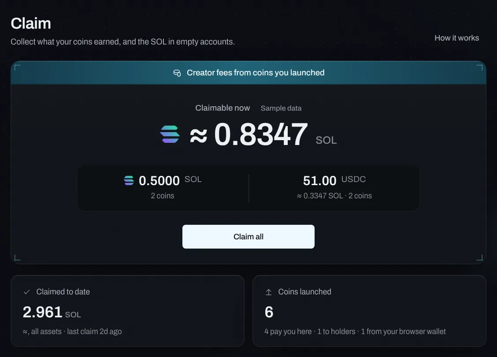
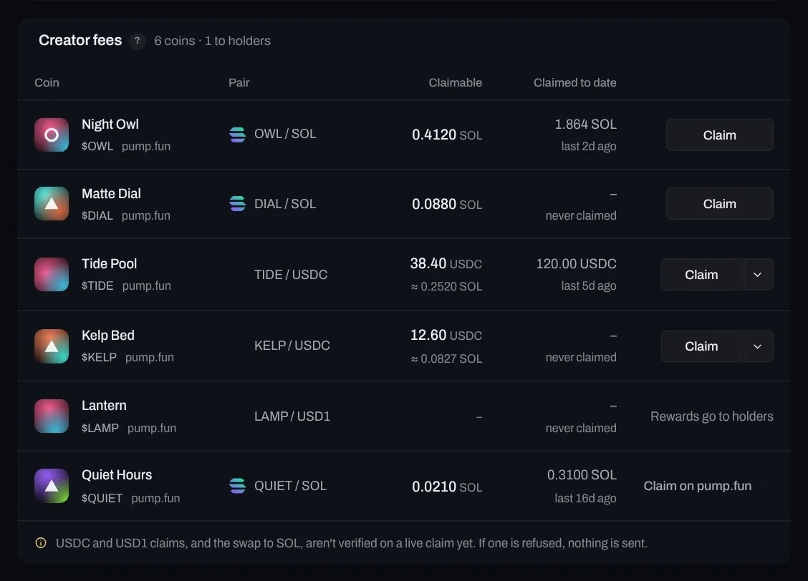
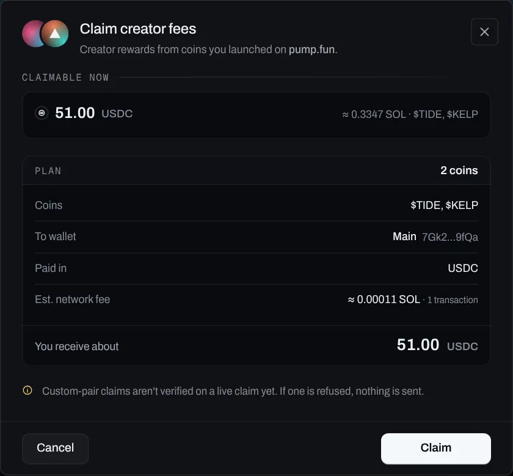
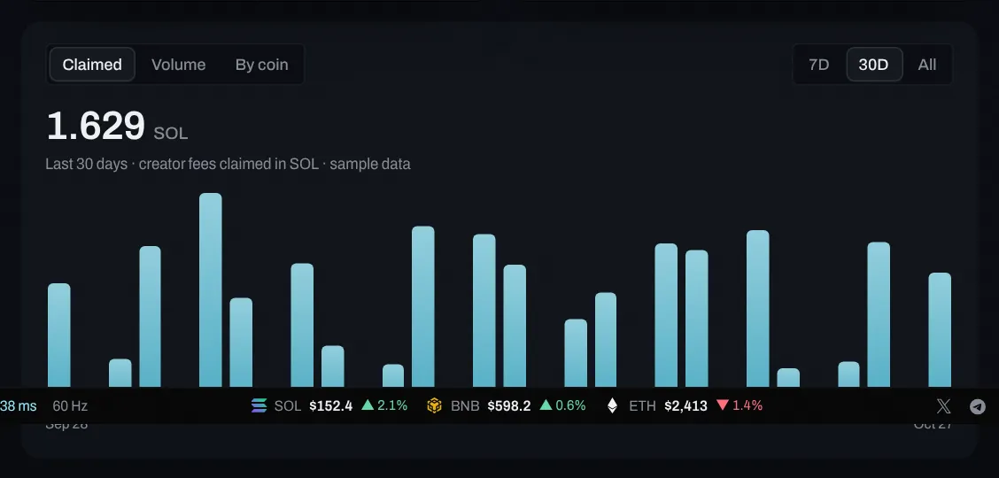
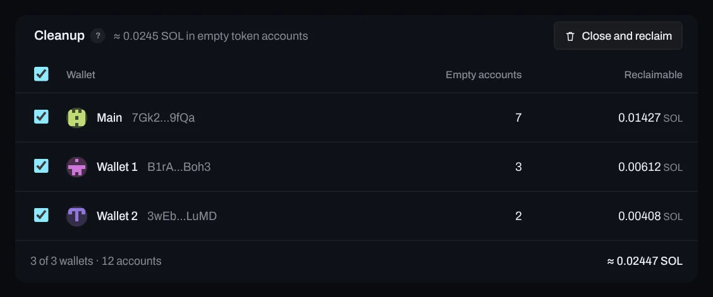

# Claim

**Claim** collects two different things. They have nothing to do with each other; they just both put SOL back in your wallet, so they share a page.

| | Creator fees | Cleanup |
|---|---|---|
| What it is | Rewards from coins **you launched** on pump.fun: every trade on your coin pays you a small fee | SOL locked as **rent** in empty token accounts in your wallets |
| Paid in | The coin's quote asset: SOL, or the custom pair's asset (USDC, a tokenized stock…) | SOL |
| Where it comes from | Other people trading your coin | Your own wallets: about 0.002 SOL per token you've held and emptied |
| Who has it | Anyone who launched a coin with creator rewards to the creator | Anyone who has traded |
| Where | Claim → **Creator fees** | Claim → **Cleanup** |

## In the panel

Sidebar → **Claim** (under Agent), or ⌘K → "Claim" or "Claim all creator fees". The page has the two parts below, one after the other: **Creator fees** at the top, **Cleanup** under it. The old Wallets → Recover rent link opens it at **Cleanup** (`/app/claim#cleanup`).

## Creator fees

Creator fees are rewards from coins you launched on pump.fun. Every buy and sell of your coin pays a small fee to its creator, in the coin's **quote asset**: SOL for a SOL pair, and the pair's own asset for a custom pair (USDC, USD1, NVDAx…). You claim it as that asset, and it lands in your wallet as that asset. The fees wait on pump.fun, per asset, until you claim them.

<!-- flow: fees "Creator fees wait per asset; one claim per asset collects them. Sample data." -->

### Step by step

1. **Open Claim.** The card at the top says what's waiting right now: the ≈ SOL total, large, with the split per asset under it.

   

2. **Find the coin.** **Creator fees** has one row per coin you launched: its pair, what's claimable, what you've claimed and the one action.

   

3. **Claim one, or all.** A row's **Claim** and **Claim all** open the same dialog. Check the Plan (the coins, the wallet the fees land in, the network fee), then claim. The progress and the result stay in the dialog.

   

4. **See what they've earned.** The chart shows what you claimed per day (**Claimed**) or per coin (**By coin**), over 7 days, 30 days or all time.

   

### The rows

| Column | What it shows |
|---|---|
| Coin | Its picture, name, ticker and launchpad |
| Pair | The quote asset with its mark, e.g. `OWL / SOL`, `TIDE / USDC` or `SIGNAL / NVDAx` (a neutral token glyph where no official mark is on disk) |
| Claimable | The amount in that asset, with ≈ SOL where a price is known. "Not reported" when the venue doesn't report it (claiming still works) |
| Claimed to date | The total claimed in that asset and when you last claimed |

- **Claim** on a SOL row. pump.fun pays creator fees per creator wallet, so one claim collects every SOL-pair coin of that wallet.
- **Claim** on a custom-pair row: one claim per asset and wallet, paid in that asset.
- **Rewards go to holders** for coins launched with rewards **To holders**: nothing to claim.
- **Claim on pump.fun** for coins launched from your browser wallet: Vesk can't sign for it.

### The claim dialog

- **What you claim**: the coins' pictures and one line, *Creator rewards from coins you launched on pump.fun.*, then what's waiting per asset.
- **The Plan**: the coins, the wallet, the estimated network fee and how many transactions, and what you receive, in each asset.
- **Progress**: *Preparing* (it re-reads what's claimable), *Claiming* (one request per asset and wallet), *Done*, with a row per coin. A step only moves when its request answers.
- **Done**: the green success mark, the amount counts up, the transactions are listed (in the preview: *Preview: no transaction*), and one notification with the same steps confirms it. The page scrolls back to its total, which gets a short sweep of light as it settles.

If a claim fails, the reason sits on that claim's coins, and **Retry failed** sends only what didn't go through.

### Chat

"claim my fees" or "collect fees for $OWL" shows what it understood; **Review and claim** opens **Claim all** to confirm. Nothing is signed from the chat itself.

## Cleanup

Cleanup is rent recovery, not earnings. Every token your wallet has held has a **token account**, and Solana keeps about **0.002 SOL** of rent in each one. When you sell everything, the account stays behind, empty, with the rent still in it. Closing it gives the rent back. It has nothing to do with the coins you launched: any wallet that trades collects these.

<!-- flow: rent "Cleanup closes empty token accounts and returns their rent. Sample data." -->

1. **Open Cleanup.** Claim → **Cleanup** (or the old Wallets → Recover rent link). It lists the wallets that have empty accounts, how many each has and the SOL to reclaim. Wallets with nothing to close are a count in the footer.

   

2. **Close and reclaim.** Pick the wallets, press **Close and reclaim**, check the total in the confirmation, then confirm. One transaction per batch of accounts; the SOL lands in the same wallet.

Accounts for coins you still hold are never touched, and an account with any balance isn't "empty". From the terminal: `vesk rent`.

## From the terminal

The everyday claim, in the panel and from the terminal:

```panel tab="Panel"
Claim › Claim all
Claim › a coin's row › Claim
```

```bash tab="CLI"
vesk claim --all
vesk claim '$OWL'
```

Every option:

```bash
vesk claim                        # the coins this agent launched, by pair; then asks to claim
vesk claim --all --yes            # one claim per asset and wallet, no questions
vesk claim '$OWL'                 # one coin (and whatever else the same claim collects)
vesk claim --json                 # rows and the claims it would send
vesk rent                         # Cleanup (not fees): close empty token accounts, get the rent back
```

The agent records the coins it launches (pair, where creator rewards go, the fee you set), so `vesk claim` knows each coin's asset. It can't read unclaimed amounts from the venue, so it doesn't guess them: each claim collects what's there and prints how much arrived. Coins with rewards to holders are listed and skipped.

Chat works too: `vesk chat "claim my fees"` shows the same claims and asks before claiming. In Telegram, the bot answers with a **Claim** button. Over MCP: `vesk_creator_fees` (read-only) and `vesk_claim_fees` (needs `VESK_MCP_ALLOW_TRADES=1` and `confirm: true`). See [CLI](16-cli.md) and [MCP](12-mcp.md).

The agent also claims on a schedule for coins you hand it (**Run your coin → Claim creator fees**, hourly). Every claim is in the treasury report with its transaction, in the asset it was paid in (`vesk treasury`).

## Limits and what's approximate

- **Verify on first live launch.** Claiming fees paid in a quote asset adds a field to PumpPortal's `collectCreatorFee` request (`quoteMint`, from `core/src/launch/capabilities.ts`). That field and whether one claim collects every coin of a wallet on that pair ran only against local mocks. SOL-pair claims use the request that has been used all along. If PumpPortal refuses, nothing is sent.
- **≈ SOL** values for stablecoin pairs use the current SOL price. What you claim stays in the asset it was paid in.
- **Unclaimed amounts** show only where the venue reports them; the hosted panel and the agent show "Not reported" until a source is wired. The offline preview shows sample amounts, labelled.
- Custom-pair mints come from the pair list (`core/src/launch/pairs.ts`) and are read on chain before every launch. USD1's mint is marked *Verify mint*. See [Launch and presets](06-launch-and-presets.md#custom-pairs).
